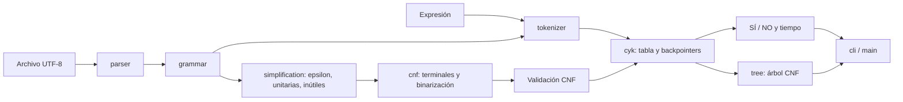

# Proyecto 2 - Algoritmo CYK

## Integrantes

- **Emilio Josué Chen Borrayo**
  - GitHub: [EmilioChenf](https://github.com/EmilioChenf)
  - Correo: che24841@uvg.edu.gt
- **Brian**
  - GitHub: [ChenBrian833](https://github.com/ChenBrian833)
  - Correo: 5.68bol@gmail.com

## Descripción

Aplicación de consola y biblioteca en Rust para leer una gramática libre de
contexto (CFG), simplificarla, convertirla a Forma Normal de Chomsky (CNF) y
determinar mediante CYK si una expresión pertenece a su lenguaje. Muestra
**SÍ/NO**, el tiempo de CYK y un árbol sintáctico para entradas aceptadas.

El programa procesa las gramáticas desde archivos; las producciones de los
ejemplos no están incorporadas en los algoritmos. Solo utiliza la biblioteca
estándar de Rust: **no tiene dependencias externas**.

## Objetivos

- Implementar eliminación de epsilon, unitarias y símbolos inútiles.
- Transformar automáticamente CFG a CNF y validar la forma de todas las reglas.
- Implementar CYK con programación dinámica y recuperar una derivación válida.
- Separar errores léxicos de expresiones sintácticamente rechazadas.
- Documentar y comprobar los casos del profesor y otras gramáticas.

## Requisitos

- Rust y Cargo instalados con [rustup](https://rust-lang.org/tools/install/).
- Versión mínima declarada: Rust 1.74, edición 2021.
- Componentes `rustfmt` y `clippy` para validación.
- En Windows con MSVC: herramientas de compilación C++ y Windows SDK.
- Terminal con UTF-8 para mostrar tildes, `ε` y ramas del árbol.

Validado el **18 de octubre de 2026** en Windows, con Rust 1.97.0 y Cargo 1.97.0.
No se necesita Python, Java, un navegador ni acceso a Internet para ejecutar
este proyecto después de instalar Rust.

## Instalación

Desde esta carpeta del repositorio, donde está `Cargo.toml`:

```console
rustup component add rustfmt clippy
cargo build
```

Si la terminal está en la carpeta contenedora `pro2 Teoria`, primero ejecute:

```powershell
cd proyecto2teoriabrianemilio
```

Si Rust ya está instalado pero `cargo` no se reconoce en PowerShell, abra una
terminal nueva o ajuste únicamente el PATH de la sesión:

```powershell
$env:Path = (Join-Path $env:USERPROFILE '.cargo\bin') + ';' + $env:Path
```

## Ejecución

```console
cargo run -- 1.txt "id * id + id"
cargo run -- 1-cnf.txt "(id * id) + id"
cargo run -- examples/english.txt "she eats a cake with a fork"
cargo run -- --ignore-case examples/english.txt "The cat drinks the beer"
cargo run -- --verbose 1.txt "(id+id)*id"
cargo run -- --help
```

Para ingresar una expresión por consola:

```console
cargo run -- 1.txt
```

Sin argumentos, `cargo run` usa `examples/english.txt` y solicita una frase:
este modo permite demostrar el caso principal ingresando únicamente el texto.
Se analiza una expresión por ejecución. Las rutas relativas se resuelven desde
el directorio actual; ejecute los ejemplos desde la raíz del repositorio.

Opciones:

| Opción | Comportamiento |
| --- | --- |
| `--verbose` | Conjuntos, etapas intermedias y tabla CYK completa |
| `--ignore-case` | Convierte la entrada a minúsculas; exige terminales en minúsculas |
| `--help`, `-h` | Ayuda y ejemplos |
| `--` | Termina las opciones para argumentos que empiezan por `-` |

La coincidencia es sensible a mayúsculas por defecto. Para las frases `She ...`
y `The ...` del enunciado se ofrece `--ignore-case`. Las hojas del árbol
corresponden a los tokens normalizados cuando se usa esa opción.

Códigos de salida: **0** = aceptada o ayuda; **1** = rechazada; **2** = error de
archivo, gramática, tokenización, argumentos o límite de recursos. Cargo puede
añadir un mensaje de salida no exitosa cuando el resultado es NO; es esperado.

### Cadena vacía

Ejecute `cargo run -- examples/epsilon.txt` y presione Enter sin escribir texto.
La entrada vacía se acepta solo si el inicial deriva epsilon; de otro modo se
imprime NO y se explica que la gramática no genera la expresión vacía.
El fin de archivo sin recibir una línea sí es un error de entrada.

## Formato de gramática

Archivo UTF-8, una producción por línea y símbolos del lado derecho separados
por espacios:

```text
E -> T X
X -> + T X | e
T -> F Y
Y -> * F Y | e
F -> ( E ) | id
```

- `->` separa los lados; `|` separa alternativas.
- `e` o `ε`, solos en una alternativa, representan epsilon. No son terminales.
- El **primer lado izquierdo** define el símbolo inicial.
- Todos los símbolos declarados a la izquierda son variables. Se hace una
  primera pasada completa para reconocer referencias a declaraciones posteriores.
- Los demás símbolos son terminales, excepto los que empiezan en mayúscula:
  estos se consideran referencias a variables y deben declararse. Use terminales
  en minúsculas y puntuación, como en las gramáticas del profesor.
- Una variable comienza con letra o `_` y continúa con letras, dígitos, `_` o `'`.
- Se fusionan líneas repetidas y se eliminan producciones duplicadas.
- Se ignoran líneas vacías, espacios adicionales, BOM UTF-8 y líneas que comienzan
  por `#`. No se admiten comentarios al final de una producción.
- Alternativas vacías, epsilon mezclado, lados izquierdos inválidos y separadores
  incorrectos generan errores con número de línea.
- Los símbolos literales `|`, `->`, `e` y `ε` están reservados por este formato.
  No hay sintaxis de comillas ni terminales con espacios internos.

La expresión usa los terminales del archivo original. El tokenizador elige la
coincidencia más larga, respeta fronteras de palabra y admite puntuación pegada:
`(id*id)+id` produce `( id * id ) + id`. Las palabras se separan mediante espacios;
`idid` no se interpreta como `id id`. Una palabra desconocida es un error léxico,
mientras que `id id` se tokeniza y recibe NO por CYK.

## Arquitectura / Diseño de la aplicación



| Módulo | Responsabilidad |
| --- | --- |
| `grammar.rs` | `Grammar`, `Production`, `Symbol`, conjuntos, nombres y representación textual |
| `parser.rs` | Lectura UTF-8 y clasificación/validación en dos pasadas |
| `tokenizer.rs` | Tokenización por vocabulario y fronteras de palabra |
| `simplification/epsilon.rs` | Anulables y combinaciones de omisión |
| `simplification/unit.rs` | Cierres unitarios y sustitución de reglas |
| `simplification/useless.rs` | Generadores y alcanzables |
| `simplification/mod.rs` | Secuencia de simplificación y límite de expansión |
| `cnf.rs` | Etapas de conversión, aislamiento de terminales, binarización y validador |
| `cyk.rs` | Programación dinámica, backpointers y cronómetro |
| `tree.rs` | Reconstrucción, hojas y dibujo del árbol |
| `cli.rs` | Argumentos, entrada interactiva y presentación |
| `error.rs` | Error recuperable y alias `Result<T>` |
| `main.rs` / `lib.rs` | Entrada del ejecutable / API pública reutilizable |

`BTreeSet` evita reglas duplicadas y `BTreeMap` permite resultados deterministas.
Epsilon es un RHS vacío. Un conjunto vacío de producciones después de simplificar
representa el lenguaje vacío; no se confunde con una gramática fuente vacía inválida.

## Algoritmo de simplificación

### Epsilon

1. Obtener el menor punto fijo de variables anulables: una regla vacía agrega su
   LHS; una regla de variables ya anulables agrega también su LHS.
2. Si el inicial es anulable y aparece en un RHS, introducir `S_INICIO` sin
   colisiones, con una regla unitaria hacia el inicial anterior.
3. Para cada ocurrencia de una variable anulable, generar las opciones de
   conservarla u omitirla. Los conjuntos eliminan combinaciones duplicadas.
4. Eliminar reglas vacías de otras variables y conservar epsilon solo en el inicial.

La enumeración no usa máscaras enteras, por lo que funciona con más de 64
ocurrencias anulables. La cantidad de alternativas distintas sí puede ser
exponencial; se devuelve un error si la expansión supera 100 000 combinaciones
o producciones durante una etapa.

### Unitarias

Para cada variable se calcula el cierre reflexivo/transitivo de reglas `A -> B`
mediante una cola y un conjunto de visitados. Se copian al origen las reglas no
unitarias de todo el cierre. Los ciclos y autorreferencias terminan sin recursión.

### Símbolos inútiles

Primero se calcula por punto fijo qué variables pueden generar una secuencia de
terminales, incluso vacía, y se eliminan las demás y las reglas que las contienen.
Después se recalcula la alcanzabilidad desde el inicial sobre la gramática
resultante. Este orden evita dejar símbolos que eran alcanzables solo a través
de una producción no generadora.

## Conversión a CNF

Después de simplificar:

1. En RHS de longitud mayor o igual a dos, cada terminal se reemplaza por una
   variable auxiliar compartida: por ejemplo, `a A` pasa a `T_a A`, con `T_a -> a`.
2. Una regla larga `S -> A B C D` se descompone en `S -> A B_S`,
   `B_S -> B B_S_1`, `B_S_1 -> C D`.
3. Se valida que toda regla sea `A -> B C`, `A -> a` o la excepción `S -> ε`.

Los nombres son deterministas: puntuación se codifica en hexadecimal, por
ejemplo `T_u2b_` para `+`; sufijos numéricos evitan colisiones con símbolos
existentes. La CNF obtenida puede tener nombres o más auxiliares que `1-cnf.txt`:
lo exigido es equivalencia de lenguaje y reglas válidas, no igualdad textual.

**Convención usada:** sin epsilon se permite el inicial en un RHS, como ocurre
con `E` en `1-cnf.txt`. Si existe `S -> ε`, se exige que ese inicial no aparezca
a la derecha. Esta variante de CNF es suficiente para CYK y permite reconocer
el archivo del profesor como CNF. Una gramática ya en CNF también pasa por la
simplificación; pueden desaparecer reglas inútiles, sin cambiar el lenguaje.

## Algoritmo CYK

La celda `table[i][longitud - 1]` contiene las variables que generan los tokens
del intervalo que comienza en `i` y tiene esa longitud.

1. La diagonal se llena con cada `A -> token` compatible.
2. Para cada longitud desde 2 hasta `n`, se recorren posiciones y todos los
   puntos de división `k`.
3. Para cada `A -> B C`, si `B` aparece en la celda izquierda y `C` en la derecha,
   se agrega `A` a la celda actual junto con un backpointer.
4. Se acepta si el inicial aparece en la celda que cubre los `n` tokens.
5. Para cero tokens se consulta la producción epsilon del inicial.

El reconocimiento es iterativo; la reconstrucción posterior del árbol sí recorre
los backpointers recursivamente. La estructura triangular reserva `n(n+1)/2`
celdas. Cada variable de una celda guarda solo una derivación.

Para una gramática fija, el tiempo es **O(n³)** y el espacio de tabla **O(n²)**.
Al considerar la gramática, se examinan O(n³ · |P₂|) reglas binarias y las consultas
a conjuntos ordenados cuestan O(log(|V|+1)); el espacio es O(n² · |V|) entradas,
además del almacenamiento de nombres y reglas. Aquí `P₂` son las reglas binarias
y `V` las variables. Se limita la entrada a **512 tokens** antes de asignar la tabla.

### Tiempo

Se utiliza `std::time::Instant` dentro de `recognize`. La medición incluye el
índice de reglas terminales, la lista de reglas binarias, la asignación y llenado
de la tabla y la decisión final. Excluye validación CNF previa, lectura de archivo,
transformaciones, tokenización, copia de salida, reconstrucción e impresión.
Se presenta en microsegundos; cambia entre ejecuciones y equipos. Para medir
con optimización, use `cargo run --release -- ...`.

## Parse Tree

Cada celda asocia una variable con una hoja terminal o con la división y los
nombres de sus dos hijos. A partir del inicial y la celda completa se reconstruye
un árbol válido de la **gramática CNF**, incluidas las variables auxiliares.
No se afirma recuperar las producciones originales eliminadas al simplificar.

Para gramáticas ambiguas se elige la primera derivación según divisiones y reglas
ordenadas. Las hojas se pueden recuperar mediante `yield_tokens()`; los tests
verifican tanto esas hojas como la validez de cada producción utilizada.

Ejemplo real para `cargo run -- 1-cnf.txt "id + id"`:

```text
E
├── T
│   └── id
└── X
    ├── P
    │   └── +
    └── T
        └── id
```

## Ejemplos de ejecución

Los siguientes resultados se comprobaron ejecutando el binario y también en
la suite automatizada. Para los dos archivos aritméticos se obtuvo lo mismo:

| Entrada | Esperado | Obtenido con `1.txt` | Obtenido con `1-cnf.txt` |
| --- | --- | --- | --- |
| `id` | SÍ | SÍ | SÍ |
| `id + id` | SÍ | SÍ | SÍ |
| `id * id` | SÍ | SÍ | SÍ |
| `id * id + id` | SÍ | SÍ | SÍ |
| `(id)` | SÍ | SÍ | SÍ |
| `(id + id)` | SÍ | SÍ | SÍ |
| `(id * id) + id` | SÍ | SÍ | SÍ |
| `+ id` | NO | NO | NO |
| `id +` | NO | NO | NO |
| `id * + id` | NO | NO | NO |
| `( id` | NO | NO | NO |
| `id id` | NO | NO | NO |

| Gramática | Entrada | Esperado | Obtenido |
| --- | --- | --- | --- |
| Inglesa | `she eats a cake with a fork` | SÍ | SÍ |
| Inglesa | `the cat drinks the beer` | SÍ | SÍ |
| Inglesa | `she a eats cake` | NO | NO |
| Inglesa | `the cat the beer drinks` | NO | NO |
| Inglesa, `--ignore-case` | `She eats a cake with a fork` | SÍ | SÍ |
| Epsilon | cadena vacía | SÍ | SÍ |
| Epsilon | `a a a` | SÍ | SÍ |
| Inútiles | `c` | NO | NO |
| `1.txt` | `id @ id` | error léxico | error, código 2 |

Son **33 casos de consola comprobados**, adicionales a los 86 tests de Cargo.
La gramática inglesa comprueba sintaxis: también acepta frases semánticamente
extrañas como `the beer cuts a cat`, porque sus producciones lo permiten.

## Pruebas

```console
cargo fmt
cargo fmt --check
cargo check
cargo test
cargo clippy --all-targets --all-features -- -D warnings
cargo build --release
```

Resultado observado: **86 tests aprobados, 0 fallidos, 0 ignorados**.

| Suite | Tests | Alcance |
| --- | ---: | --- |
| `parser_tokenizer.rs` | 25 | Archivos, símbolos, formato, errores, Unicode, lexer y argumentos |
| `transformations.rs` | 28 | Anulables, epsilon, cierres, inútiles, terminales, binarización y CNF |
| `cyk_examples.rs` | 20 | Archivos del profesor, inglés, tabla, árboles, epsilon y límites |
| `cli.rs` | 11 | Ejecutable real, códigos de salida, modo interactivo y opciones |
| `language_equivalence.rs` | 2 | Oráculo independiente y comparación exhaustiva acotada |
| **Total** | **86** | **Todos aprobados** |

El oráculo obtiene por punto fijo el lenguaje acotado de la CFG original,
sin usar CYK ni CNF. Compara 8 gramáticas dirigidas para todas las 63 palabras
de `{a,b}` de longitud 0 a 5, y 24 gramáticas generadas reproduciblemente para
las 31 palabras de longitud 0 a 4: **1248 decisiones contrastadas**, incluidas
aceptaciones y rechazos. Esto complementa las pruebas específicas; no constituye
una demostración exhaustiva para todas las gramáticas posibles.

Formato, `cargo check`, Clippy con advertencias como errores y compilación
`release` finalizaron correctamente. La evidencia y los comandos de demostración
se documentan también en [docs/VALIDACION.md](docs/VALIDACION.md).

## Discusión

**Epsilon y ciclos:** eliminar únicamente las reglas vacías cambia el lenguaje.
Se calculan anulables y omisiones; se aísla el inicial cuando es necesario.
Los cierres unitarios con visitados resuelven ciclos sin repetir indefinidamente.

**CNF y conservación:** reconocer solo la forma de las reglas no demuestra
equivalencia. Por ello se comprobaron tanto la postcondición CNF como los
lenguajes pequeños con un algoritmo independiente. La gramática vacía que
resulta de eliminar todos los no generadores representa correctamente ∅.

**Tokenización:** los paréntesis pegados exigieron un lexer basado en el
vocabulario, mientras que las palabras necesitan fronteras para no aceptar
prefijos de palabras desconocidas. Se conserva el vocabulario original aunque
la simplificación elimine algunos de sus terminales, para producir NO en vez de
un error léxico en esos casos.

**Reconstrucción:** guardar árboles completos durante cada combinación duplicaría
trabajo. Un backpointer por variable y celda permite dibujar un solo árbol después
del reconocimiento. Se muestran explícitamente los auxiliares CNF.

**Material de referencia:** el PDF principal se pudo extraer y revisar visualmente.
`Ejemplo Proyecto 2.pdf` tiene cinco páginas con errores de compresión; dos lectores
independientes no recuperaron contenido y el renderizado quedó blanco. Se conserva
el archivo original, sin atribuirle contenido no verificable. Los TXT sí se leyeron
y comprobaron. Conviene sustituir el PDF de ejemplo por una copia legible si el
profesor necesita que se contraste su contenido visual.

**Entorno:** Rust estaba instalado, pero fuera del PATH de la sesión. Se resolvió
usando sus herramientas existentes. Las herramientas auxiliares utilizadas para
inspeccionar los PDF no son dependencias del programa.

**Recomendaciones:** use `--verbose` para explicar una expresión corta; omítalo
para entradas largas. Mantenga palabras separadas por espacios y use el modo
interactivo para epsilon. La conversión puede crecer exponencialmente; los límites
devuelven errores explícitos en lugar de resultados inventados. Para entradas
mayores podría sustituirse el almacenamiento de nombres por identificadores y
bitsets, manteniendo las mismas pruebas de equivalencia.

## Conclusiones

La simplificación y conversión permiten aplicar una única implementación de CYK
a las expresiones aritméticas y frases inglesas. Los backpointers proporcionan
evidencia de una aceptación mediante una derivación verificable. La separación
de parser, transformaciones, reconocimiento y presentación facilita comprobar
los algoritmos individualmente y reutilizarlos con nuevas gramáticas.

## Distribución del trabajo

La tabla describe las unidades registradas bajo cada autor en los commits nuevos,
con la asistencia de Codex solicitada para el desarrollo. No modifica ni reasigna
el commit inicial del repositorio.

| Autor Git | Unidades registradas | Commits nuevos |
| --- | --- | ---: |
| EmilioChenf (`che24841@uvg.edu.gt`) | Modelo Rust; parser/tokenizador; epsilon; CYK; README y referencias; validación reproducible y reporte | 6 |
| ChenBrian833 (`5.68bol@gmail.com`) | Unitarias; inútiles; CNF; árbol; CLI; pruebas y gramáticas adicionales | 6 |

Para consultar la evidencia real:

```console
git log --reverse --format="%h | %an | %ae | %s" eef53cd..HEAD
git shortlog -sne eef53cd..HEAD
git shortlog -sne HEAD
git status --short --branch
```

El último `shortlog` incluye también el commit inicial de Emilio con otro correo;
el reparto 6/6 corresponde únicamente a los commits nuevos de este desarrollo.
Se conservó la configuración de usuario: las identidades se aplicaron con
`git -c` a cada commit, sin cambiar la configuración local ni global.

## Referencias

- [Enunciado del profesor](Proyecto%20No%202.pdf): objetivos, gramática inglesa,
  programación dinámica, salidas y ponderación 7/7/1.
- [CFG aritmética](1.txt) y [CNF aritmética](1-cnf.txt): archivos de entrada y pruebas.
- [The CYK Algorithm, UC Davis](https://www.cs.ucdavis.edu/~rogaway/classes/120/winter12/CYK.pdf):
  estructura del algoritmo de llenado de tabla.
- [Rust: Instant](https://doc.rust-lang.org/std/time/struct.Instant.html): medición de duración.
- [Cargo: fmt](https://doc.rust-lang.org/cargo/commands/cargo-fmt.html) y
  [Clippy: uso](https://doc.rust-lang.org/stable/clippy/usage.html): validaciones de calidad.
